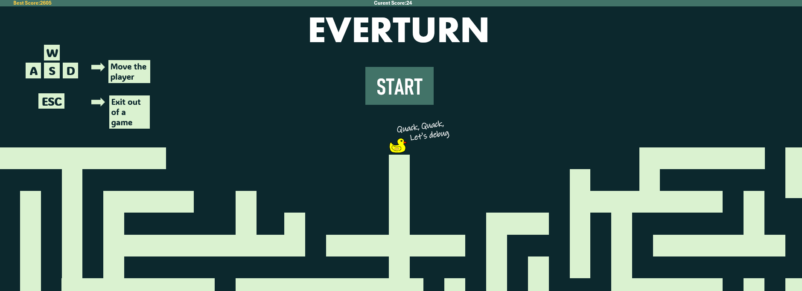
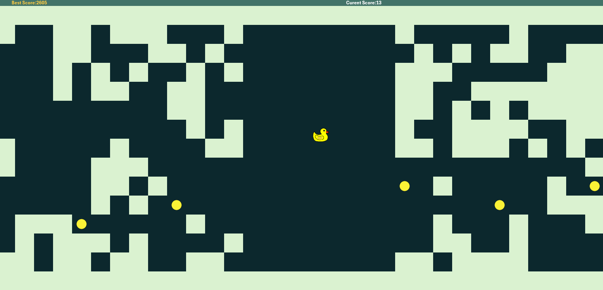
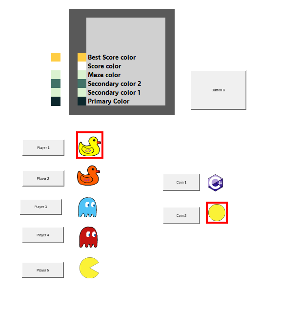

<h1>EVERTURN</h1>

An endless game where you navigate through a moving &quot;maze&quot; (it is more like a cave, but that is the best description I have) made in Excel VBA. This project was created for the Wrong Event by Hack Club.

 
<h2>HOW TO PLAY</h2>

To play, simply download the <code>.xlsm</code> file from the Game folder and run it in Microsoft Excel. Make sure to enable macros if prompted.

 
<h2>CONTROLS</h2>
<table border="1" cellpadding="8" style="border-collapse: collapse; width: 100%;">
    <thead>
        <tr style="background-color: #f8f9fa;">
            <th style="text-align: left;">Key</th>
            <th style="text-align: left;">Action</th>
        </tr>
    </thead>
    <tbody>
        <tr>
            <td>W, A, S, D</td>
            <td>Move the player</td>
        </tr>
        <tr>
            <td>Esc</td>
            <td>Stop the current game session</td>
        </tr>
    </tbody>
</table>

<h2>ASSETS</h2>

All assets were custom-made by me in Aseprite, inspired by Pac-Man and Duck Debugging.

This image also shows the settings, which work as follows: simply click the button next to the skin you want to use to select it. You can choose from 5 skins for the player and 2 skins for the coin.

The cells on top of the assets are the color customization cells. Simply change the color and click the button next to them to apply it.

<h2>BUILDING PROCESS</h2>

I initially started designing the game in Figma. However, due to a lack of necessary features, I moved the development to Excel VBA.

I used AI tools to study VBA, but 90% of the code was written by me. Because of this, the game runs a bit sluggishly, but I am proud of it since I took the time to actually learn the language and build this project from scratch.

<h2>OTHER</h2>

I plan to update this at least once to add the proper settings, more assets, and hopefully a shop.

I hope you have fun playing the game! :)

